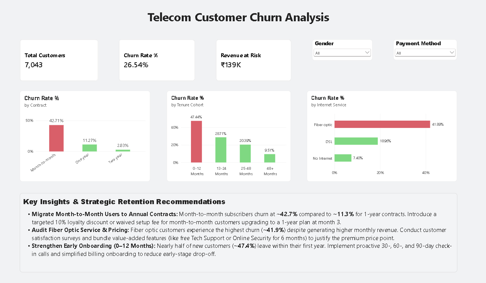

# Telecom Customer Churn Analysis (End-to-End Portfolio Project)

## 📌 Project Overview
Customer retention is one of the primary revenue drivers in the telecommunications industry. This end-to-end data analytics project investigates customer demographics, account details, and service usage across **7,043 subscribers** to identify key churn drivers, quantify monthly revenue at risk, and recommend targeted retention strategies.



**Tech Stack:**
* **Data Cleaning & Preprocessing:** Python (`Pandas`, `NumPy`, `SQLAlchemy`)
* **Exploratory Data Analysis (EDA):** MySQL Workbench
* **Data Visualization & Reporting:** Microsoft Power BI

---

### Key Performance Indicators (KPIs)
* **Total Customers:** `7,043`
* **Overall Churn Rate:** `26.54%` (`1,869` churned customers)
* **Monthly Revenue at Risk:** ` ₹139K`

---

## 🔍 Key Analytical Findings

1. **Contract Commitment Is the Strongest Churn Predictor:**
   * **Month-to-month** subscribers churn at **42.71%**, nearly **4× higher** than **1-year** contracts (**11.27%**) and **15× higher** than **2-year** contracts (**2.83%**).
2. **First-Year Onboarding Is the Critical Drop-Off Window:**
   * Subscribers in their first year (**0–12 Months**) experience a **47.44%** churn rate. Once customers pass the 12-month mark, attrition drops sharply to **28.71%** (13–24 months) and stabilizes at **9.51%** for tenures exceeding 48 months.
3. **High-Tier Fiber Optic Plans Exhibit Severe Attrition:**
   * Despite generating higher monthly recurring revenue, **Fiber optic** users churn at **41.89%**—more than double the churn rate of **DSL** subscribers (**18.96%**) and over 5× higher than customers with **No Internet** service (**7.40%**).

---

## 💡 Strategic Retention Recommendations

* **Migrate Month-to-Month Users to Annual Contracts:** Introduce a targeted 10% loyalty discount or waived setup fee for month-to-month subscribers upgrading to a 1-year plan at month 3.
* **Audit Fiber Optic Service & Pricing:** Conduct customer satisfaction surveys and bundle value-added features (such as free Tech Support or Online Security for the first 6 months) to justify the premium price point.
* **Strengthen Early Onboarding (0–12 Months):** Implement proactive 30-, 60-, and 90-day check-in calls alongside simplified billing onboarding to reduce early-stage drop-off.

---

## 🛠️ Tech Stack & Workflow

1. **Data Cleaning & Feature Engineering (`notebooks/`):**
   * Handled blank string values in `TotalCharges` for zero-tenure customers using `pandas` (`pd.to_numeric` + zero imputation).
   * Engineered a binary `Churn_Numeric` flag and segmented continuous `tenure` into four actionable cohorts (`0-12 Months`, `13-24 Months`, `25-48 Months`, `48+ Months`).
2. **Exploratory Data Analysis (`sql/`):**
   * Imported the cleaned dataset into **MySQL** to aggregate baseline KPIs, segment churn exposure across contract types and service tiers, and isolate compound high-risk customer profiles.
3. **Executive Visualization (`dashboard/`):**
   * Built a single-page **Power BI** report using custom DAX measures (`Total Customers`, `Churn Rate %`, `Revenue at Risk`), conditional risk color-coding, and dynamic dropdown slicers.

---

## 🗂️ Repository Structure
```text
telecom-customer-churn-analysis/
│
├── data/
│   ├── raw/
│   │   └── WA_Fn-UseC_-Telco-Customer-Churn.csv   # Original Kaggle dataset
│   └── processed/
│       └── telco_churn_cleaned.csv                # Cleaned dataset ready for SQL & Power BI
│
├── notebooks/
│   └── 01_data_cleaning.ipynb                     # Python script for data wrangling & validation
│
├── sql/
│   └── 02_exploratory_data_analysis.sql           # MySQL queries uncovering churn & revenue metrics
│
├── dashboard/
│   ├── telco_churn_dashboard.pbix                 # Interactive Power BI report file
│   └── dashboard_preview.png                      # High-resolution snapshot of the dashboard
│
└── README.md                                      # Project documentation & business recommendations
```
